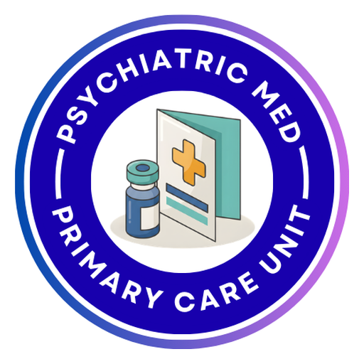

<p align="center">
  
</p>

<h1 align="center">Psychi PCU — ระบบบันทึกยาฉีดจิตเวช รพ.สต.</h1>

<p align="center">กลุ่มงานเภสัชกรรม โรงพยาบาลศีขรภูมิ</p>

เว็บแอปบันทึกการจ่ายยาฉีดจิตเวช (Long-acting injection) ออกไปฉีดที่ รพ.สต. 21 แห่ง สร้างด้วย Google Apps Script + Google Sheets ใช้ได้ทั้งมือถือและคอมพิวเตอร์ ติดตั้งเป็นแอปบนหน้าจอโฮม iOS/Android ได้

## ความสามารถ

| ฟังก์ชัน | รายละเอียด |
|---|---|
| สแกนสติ๊กเกอร์ยาด้วย AI | ถ่ายภาพสติ๊กเกอร์ Gemini อ่านข้อมูล แล้วระบบตรวจซ้ำด้วยกฎ ช่องที่ไม่แน่ใจขึ้นสีเหลือง |
| ตรวจสอบก่อนบันทึก | ข้อมูลไม่ครบ, HN ผิดรูปแบบ, บันทึกซ้ำ, จำนวน amp ไม่ตรงกับที่คำนวณ, ชื่อไม่ตรงประวัติ |
| ตารางนัดฉีดอัตโนมัติ | คำนวณจาก regimen (วันที่ของเดือน, ทุก 1–6 เดือน) ตั้งแต่วันจ่ายยาถึงก่อนวันนัดพบแพทย์ |
| ปฏิทินการฉีด | แยกตาม รพ.สต. และวันที่ ดาวน์โหลด PDF รายชื่อได้ |
| ยืนยันการฉีด | ระบุวันที่ฉีดจริงได้ ไม่จำเป็นต้องตรงวันนัด |
| รายใหม่ / รายเดิม | แยกตามปีงบประมาณ (ตัดปีงบ 30 ก.ย.) |
| สรุปยา รพ.สต. | จำนวน amp ที่จ่ายและที่ใช้ฉีด แยกตามยาและ รพ.สต. |
| คำขอบันทึกย้อนหลัง | ห้องยา/รพ.สต. ส่งคำขอ ผู้ดูแลระบบอนุมัติก่อนข้อมูลเข้าระบบ |
| แจ้งเตือน LINE OA | ทุกเช้า 07.00 น. แยกตาม รพ.สต. (ชื่อและ HN ปิดบางส่วน) |
| เข้าสู่ระบบ | ห้องยาใช้ Google, รพ.สต. ใช้ LINE Login ผู้ดูแลระบบอนุมัติผู้ใช้ใหม่ |

## โครงสร้างโปรเจกต์

```
Psychi-PCU/
├── apps-script/          โค้ดที่วางใน Google Apps Script
│   ├── Config.gs         ค่าตั้งต้น (รพ.สต., ยา, เวลาแจ้งเตือน)
│   ├── Logic.gs          สูตรคำนวณและกฎตรวจสอบ
│   ├── Code.gs           หน้าเว็บ, ข้อมูล, คำสั่ง API
│   ├── Auth.gs           เข้าสู่ระบบ Google / LINE
│   ├── Ai.gs             Gemini อ่านสติ๊กเกอร์
│   ├── Line.gs           แจ้งเตือน LINE OA
│   ├── Pdf.gs            PDF รายชื่อนัดฉีด
│   ├── Index.html        หน้าเว็บทั้งหมด
│   └── appsscript.json   การตั้งค่าโปรเจกต์
├── docs/                 หน้าทางเข้าแอป + ไอคอน (เผยแพร่ด้วย GitHub Pages)
│   ├── index.html
│   ├── manifest.webmanifest
│   ├── sw.js
│   └── icons/
└── คู่มือติดตั้ง.md       ขั้นตอนติดตั้งและตั้งค่าแบบละเอียด
```

## การติดตั้ง

ดูขั้นตอนเต็มใน [คู่มือติดตั้ง.md](คู่มือติดตั้ง.md) สรุปสั้น ๆ ได้ดังนี้

1. สร้าง Google Sheets > ส่วนขยาย > Apps Script แล้ววางไฟล์ทั้งหมดในโฟลเดอร์ `apps-script/`
2. รันฟังก์ชัน `setup` แล้ว Deploy เป็นเว็บแอป (เรียกใช้ในฐานะ: ฉัน, ผู้เข้าถึง: ทุกคน)
3. ตั้ง Script Properties: Gemini API key, Google OAuth, LINE Login, LINE Messaging API
4. ตั้งค่าหน้าทางเข้าแอปและไอคอน (หัวข้อถัดไป)

## ติดตั้งแอปบนหน้าจอโฮม (iOS / Android)

Apps Script ตั้งไอคอนแอปบนหน้าจอโฮมเองไม่ได้ โปรเจกต์นี้จึงมี **หน้าทางเข้าแอป** ในโฟลเดอร์ `docs/` ที่มีไอคอนครบทุกขนาด เมื่อกดไอคอนบนหน้าจอโฮม หน้านี้จะพาเข้าระบบทันที

**ตั้งค่าครั้งเดียว (ผู้ดูแลระบบ)**

1. แก้ไฟล์ `docs/index.html` บรรทัด `const APP_URL = '...'` ใส่ลิงก์เว็บแอปที่ลงท้ายด้วย `/exec`
2. GitHub > Settings > Pages > Source: **Deploy from a branch** > Branch: `main` โฟลเดอร์ `/docs` > Save
3. รอ 1–2 นาที หน้าทางเข้าแอปจะอยู่ที่ `https://font-pharm.github.io/Psychi-PCU/`

**ผู้ใช้ติดตั้ง**

| ระบบ | ขั้นตอน |
|---|---|
| iPhone / iPad | เปิดลิงก์ด้วย Safari > ปุ่มแชร์ > เพิ่มไปยังหน้าจอโฮม > เพิ่ม |
| Android | เปิดลิงก์ด้วย Chrome > กดปุ่ม "ติดตั้งแอปลงหน้าจอโฮม" หรือเมนู ⋮ > ติดตั้งแอป |

ถ้าเปิดลิงก์จากในแชท LINE ให้เลือก "เปิดในเบราว์เซอร์" ก่อน เพราะเบราว์เซอร์ของ LINE ติดตั้งแอปไม่ได้

| ไอคอน | ขนาด | ใช้กับ |
|---|---|---|
| `apple-touch-icon.png` | 180×180 | iOS หน้าจอโฮม |
| `icon-192.png`, `icon-512.png` | 192, 512 | Android / Chrome |
| `maskable-192.png`, `maskable-512.png` | 192, 512 | Android ที่ตัดไอคอนเป็นวงกลม/หยดน้ำ |
| `favicon-16.png`, `favicon-32.png`, `favicon.ico` | 16, 32 | แท็บเบราว์เซอร์ |

## ความปลอดภัยของข้อมูล

- โค้ดใน repository นี้**ไม่มี**รหัสลับและข้อมูลผู้ป่วย
  - รหัสลับทั้งหมดเก็บใน Script Properties
  - ข้อมูลผู้ป่วยอยู่ใน Google Sheets ที่ไม่แชร์ให้ใคร
- **ห้าม commit** API key, token, ไฟล์ Sheets หรือภาพสติ๊กเกอร์ที่มีข้อมูลผู้ป่วยจริงลง repository นี้
- หน้าทางเข้าแอปใน `docs/` เป็นหน้าเว็บสาธารณะ มีเพียงโลโก้และลิงก์เข้าระบบ ข้อมูลทั้งหมดต้อง login ก่อน

---

กลุ่มงานเภสัชกรรม รพ.ศีขรภูมิ
